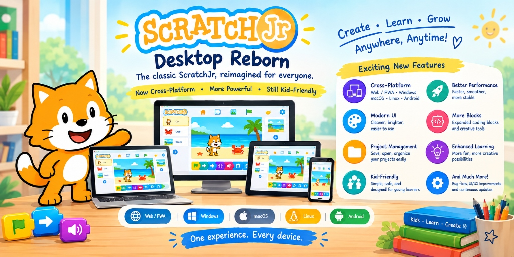

<p align="center">
  
</p>

# ScratchJr Reborn — Web/PWA, Desktop & Android

> A modernized, multi-platform edition of [ScratchJr](https://scratchjr.org/) for Web/PWA, Windows, macOS, Linux, and Android.

[](https://github.com/richiesamlie/ScratchJr-Desktop-Reborn/releases/latest)
[]()
[](LICENSE)
[]()

---

## 🚀 Launch Online & Downloads

| Edition / Target | Platform | Download & Access |
| :--- | :--- | :--- |
| **🌐 Web / PWA** | Browser (Chrome, Safari, Edge, Firefox) | **[🎮 Launch Web App](https://richiesamlie.github.io/ScratchJr-Desktop-Reborn/play/)** · Installable PWA |
| **🚀 Lightweight Desktop (Tauri v2 + Rust)** | Windows 10/11 (x64) | [**Setup.exe**](https://github.com/richiesamlie/ScratchJr-Desktop-Reborn/releases/latest) · [MSI](https://github.com/richiesamlie/ScratchJr-Desktop-Reborn/releases/latest) · [Portable ZIP](https://github.com/richiesamlie/ScratchJr-Desktop-Reborn/releases/latest) *(~30 MB RAM, WebView2)* |
| **⚡ Universal Desktop (Electron 45)** | Windows 10/11 (x64) | [MSI](https://github.com/richiesamlie/ScratchJr-Desktop-Reborn/releases/latest) · [Portable ZIP](https://github.com/richiesamlie/ScratchJr-Desktop-Reborn/releases/latest) |
| | macOS (Apple Silicon & Intel) | [Download ZIP](https://github.com/richiesamlie/ScratchJr-Desktop-Reborn/releases/latest) |
| | Linux (x64 & ARM64) | [Download ZIP](https://github.com/richiesamlie/ScratchJr-Desktop-Reborn/releases/latest) |
| **📱 Android** | Android 7.0+ (Phones, Tablets, Chromebooks) | [Download APK](https://github.com/richiesamlie/ScratchJr-Desktop-Reborn/releases/latest) · Google Play AAB |

---

## ✨ Highlights

- **Universal Multi-Target Host**: Shared TypeScript/JavaScript engine across **Web/PWA** (`sql.js` + IndexedDB), **Tauri v2** (Rust + `rusqlite`), **Electron 45** (Chromium + Node 26), and **Android** (Kotlin + SQLite WAL). Both desktop editions share the same `Documents\ScratchJR\scratchjr.sqllite` database.
- **Expanded Editor & Blocks**: Up to **10 pages per project**, horizontal flip (`flipX`), "If Touching Color" (`ontouchcolor`) with loupe eyedropper, configurable stage resolution (`480×360` SD / `960×720` HD) and custom grid snapping (`16`–`32`), drag-and-drop sprite reordering, and lobby project search & duplication.
- **Upgraded Paint Editor**: Zoom controls (`+`, `−`, `1:1`), freehand masking eraser, Normal/Flat/Dotted brushes, spectrum color picker, star/line shapes, and custom media/audio import (`.wav`, `.mp3`, `.ogg`, `.webm`, `.m4a`).
- **Safe Storage & 1-Click Sharing**: Instant `.sjr` project import/export, atomic SQLite writes with rolling `.bak` snapshots, multi-tab Web Locks protection, and self-healing sprite thumbnails.

---

## 🛠️ Quick Start & Build

**Prerequisites:** Node.js 26+ and Git (Rust 1.99+ for Tauri; JDK 17/21 + Android SDK 37 for Android).

```bash
npm install                # Install dependencies
npm test                   # Run unit suite (359 tests)
npm run typecheck          # TypeScript check
npm run lint               # ESLint 10 flat-config check

# Build targets
npm run build:renderer     # Compile renderer bundle
npm run build:web          # Build Web/PWA to dist-web/
npm run build:android      # Sync web bundle to Android assets

# Package desktop releases
npm run make:zip           # Electron portable ZIP
npm run tauri:build        # Tauri v2 MSI & NSIS installers
npm run package:tauri      # Package Tauri artifacts + SHA256SUMS to out/tauri-win32-x64/
```

---

## 📚 Documentation

- **[Architecture & Security](docs/ARCHITECTURE.md)** — Process separation, IPC boundaries, and host adapters
- **[Threat Model](docs/THREAT-MODEL.md)** — Security posture and network isolation
- **[School & Fleet Deployment](docs/SCHOOL-DEPLOYMENT.md)** — Silent MSI install flags, Intune, and GPO guides
- **[Release Runbook](docs/RELEASE.md)** — Lockstep versioning and packaging checklist
- **[GitHub Wiki](https://github.com/richiesamlie/ScratchJr-Desktop-Reborn/wiki)** — Detailed guides, IPC inventory, and changelog

---

## 🤝 Credits & License

Built on the open-source work of:
- **Original ScratchJr**: [Tufts DevTech Research Group](https://sites.tufts.edu/devtech/), [MIT Lifelong Kindergarten Group](https://www.media.mit.edu/groups/lifelong-kindergarten/overview/), and [Playful Invention Company](http://www.playfulinvention.com/) ([`scratchfoundation/scratchjr`](https://github.com/scratchfoundation/scratchjr)).
- **Desktop & Community Adaptations**: [`jfo8000/ScratchJr-Desktop`](https://github.com/jfo8000/ScratchJr-Desktop), [`JustSch/ScratchJr-Desktop`](https://github.com/JustSch/ScratchJr-Desktop), [`wangzongjun/ScratchJr`](https://github.com/wangzongjun/ScratchJr), [`patdx/scratchjr`](https://github.com/patdx/scratchjr), and [SQL.js](https://github.com/sql-js/sql.js).

Scratch and ScratchJr are trademarks of Massachusetts Institute of Technology, which does not sponsor, endorse, or authorize this content. Licensed under the [BSD 3-Clause License](LICENSE).
